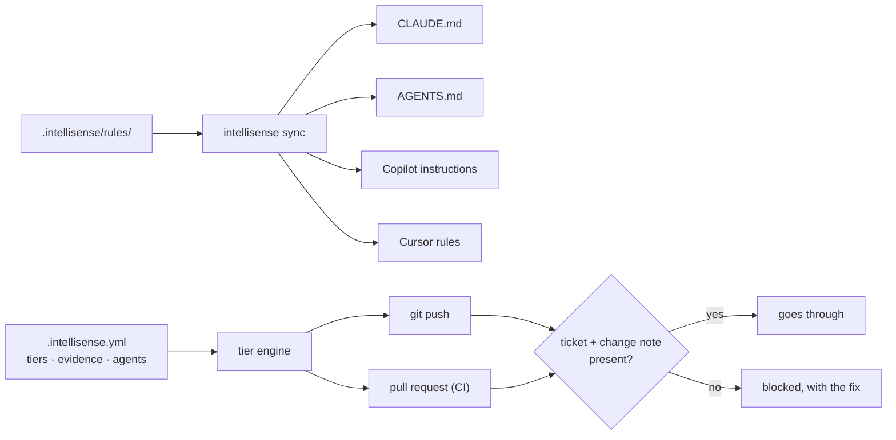

<div align="center">

# Intellisense

### A safety check for code written with AI.

**Small changes go straight through. Risky ones — payments, logins, database changes — need a ticket and a short note
before they can be pushed. It works the same for Claude Code, Codex, GitHub Copilot and Cursor.**

[](LICENSE)
[](CHANGELOG.md)
[](go.mod)
[](#install)

[What it does](#what-it-does) · [Examples](#examples) · [Get started](#get-started-in-5-minutes) · [Words we use](#words-we-use) · [Two ways to use it](#two-ways-to-use-it) · [Reference](#reference) · [FAQ](#faq)

</div>

<br />

## The problem

AI coding assistants write code fast. They fix a typo and rewrite your payment logic with exactly the same
confidence, and nobody checks which one just happened.

On top of that, each assistant reads its own instruction file — `CLAUDE.md` for Claude, `AGENTS.md` for Codex,
another file for Copilot, another for Cursor. Over time they drift apart, and each assistant follows different rules.

## What it does

Intellisense is a small command-line tool you add to a repository. It does three things:

1. **Sorts every change by risk.** It looks at which files a change touches and gives it a level:
   - **Routine** — docs, tests, comments. Nothing extra needed.
   - **Standard** — ordinary code, CI, dependencies.
   - **High risk** — logins, payments, database migrations, secrets.
2. **Asks for proof on the risky ones.** A standard or high-risk change needs two things in its commit message:
   a **ticket number** (which task is this for?) and a one-line **change note** (what does it touch, how risky is it?).
   If they are missing, the push is stopped and you are told exactly what to add.
3. **Gives every AI assistant the same rules.** You write your team's rules once; Intellisense writes them into each
   assistant's own file and warns you when someone edits one by hand.

The check runs when you `git push` and again on every pull request in CI, so it applies to every change — whoever
or whatever wrote it. It's one program with nothing else to install besides `git`.

## Examples

Each example shows the situation, what Intellisense does about it, and what you need to turn on. Examples 1–6 all
work in Core mode (`intellisense init`), with any AI assistant.

### 1. The assistant fixes a typo in the README

**What happens:** you push and it goes through. Docs, tests and comment-only edits are routine (Tier 0) and need
nothing extra.

**Set up:** nothing beyond `intellisense init`.

### 2. The assistant changes the payment code

**The situation:** you ask an assistant to add refunds, and it edits `payments/charge.go`. Without a check, the change
looks like any other commit — nobody can tell from history that money code changed, why, or whether anyone thought
about the risk.

**What Intellisense does:** `payments/` matches the built-in "financial" rule, so the change is high risk (Tier 2).
The push stops and says what's missing:

```console
$ git push
intellisense gate: Tier 2 — high risk
  Tier 2 because:
    payments/charge.go                               financial
  ✗ commit 1ac7ce5 "feat: refunds" is Tier 2 and has no task trailer
      fix: add a trailer line such as "Task: PROJ-123" to that commit's message
  ✗ this change is Tier 2 and has no change contract
      fix: add a line "Change Contract: scope=<scope>, risk=low|medium|high" to a commit message
BLOCKED: 2 problem(s).
```

You add the ticket and a one-line note, and the push goes through:

```console
$ git commit --amend -m "feat: refunds" -m "Task: PROJ-12" \
    -m "Change Contract: scope=refunds in payments, risk=high"
$ git push
PASSED
```

Now the reviewer, and anyone reading the history later, knows which ticket the change belongs to and that its author
called it high risk.

**Set up:** nothing beyond `intellisense init` — logins, payments, migrations and secrets are high risk by default.
Mark your own risky folders in `.intellisense.yml` under `tiers:`.

### 3. One rule for every AI assistant

**The situation:** your team uses Claude Code and GitHub Copilot. You want both to follow "never log card numbers".
Claude reads `CLAUDE.md`, Copilot reads `.github/copilot-instructions.md`, so you'd have to write the rule twice —
and next month someone updates one file and forgets the other.

**What Intellisense does:** you write the rule once, as a Markdown file:

```markdown
<!-- .intellisense/rules/organization/payments.md -->
---
globs: ["payments/**"]
---
# Payments

- Never log card numbers, CVVs or full bank account numbers.
```

`intellisense sync` writes it into each assistant's own format:

```console
$ intellisense sync
  created   .github/instructions/intellisense-organization-payments.instructions.md
  updated   CLAUDE.md
✓ synced 8 agent instruction files (2 changed)
```

Copilot gets a file that applies only to `payments/**`; `CLAUDE.md` gets a pointer to the rule that Claude reads when
it works there. (Codex and Cursor get theirs the same way.) If someone later edits an assistant's file by hand, the CI
check fails until it is regenerated:

```console
$ intellisense sync --check
agent instructions are out of date:
  changed   .github/copilot-instructions.md
```

**Set up:** choose your assistants at `intellisense init` (or `--agents claude,copilot,codex,cursor`), put rules in
`.intellisense/rules/organization/`, run `intellisense sync`, and commit the result.

### 4. Someone skips the check with `git push --no-verify`

**The situation:** the local check is a git hook, and anyone can skip a git hook with `--no-verify`.

**What Intellisense does:** the same check runs again on every pull request, as a GitHub Action called
**Intellisense Gate**. Make it a required check and the pull request cannot be merged until the evidence is there,
whoever pushed it and however.

**Set up:**
1. `intellisense init --ci` writes `.github/workflows/intellisense.yml`.
2. On GitHub: **Settings → Rules → Rulesets** → your branch rule → **Require status checks to pass** → add
   **Intellisense Gate**.

Other CI systems: run `intellisense check --base <ref> --head <ref>` in a job ([docs/ci.md](docs/ci.md)).

### 5. A pull request tries to loosen the rules

**The situation:** a pull request changes payment code *and* deletes the "financial" rule from `.intellisense.yml`,
hoping the payment change then counts as ordinary.

**What Intellisense does:** it judges every change by the rules on the branch being merged *into*, not the rules inside
the pull request. Even though this pull request deleted the rule, the payment file is still flagged — and the rules file
itself is high risk too:

```console
$ intellisense gate --base main
intellisense gate: Tier 2 — high risk
  Tier 2 because:
    .intellisense.yml                                governance policy
    payments/charge.go                               financial
BLOCKED: 2 problem(s).
```

To really change a rule, you change `.intellisense.yml` in its own reviewed pull request with a ticket and a note.
Once merged, it applies to later pull requests.

**Set up:** nothing — this is how the check always works.

### 6. The assistant only rewords a code comment

**The situation:** an assistant tidies a comment in an ordinary file. Asking for a ticket for that would be noise.

**What Intellisense does:** if a file isn't in a risky folder and its change only touches comments, the change is
routine:

```console
$ intellisense classify
Tier 0 — routine
  Tier 0  app/greet.go                                     fast-lane diff only changes comments
```

Two exceptions keep this safe:
- **Files in risky folders never get this shortcut.** A comment edit in `payments/charge.go` is still high risk.
- **Comments that switch something off don't count as harmless.** A comment containing words like "disable",
  "bypass", "skip validation" or "comment out" is treated as a real change:

```console
$ intellisense classify          # the comment now says "TODO: disable the rate limit check for now"
Tier 1 — standard
  Tier 1  app/greet.go                                     default   no rule matched
```

**Set up:** on by default (`fast_lane: true` in `.intellisense.yml`).

## Who it's for

- **Teams where AI writes part of the code** and risky changes should arrive with a ticket and a stated risk —
  enforced, not just hoped for.
- **Tech leads** who want one set of rules for every AI assistant the team uses.
- **Solo developers** who want a second look on the dangerous parts of their own code.

## Get started in 5 minutes

**1. Install it**

```bash
brew install soupler-oss/tap/intellisense
```

Other ways (Linux without Homebrew, Windows, Go) are under [Install](#install).

**2. Set it up in your repository**

```bash
cd your-repo
intellisense init
```

It asks a few questions — your language, which AI assistants you use, your ticket system (GitHub, Jira, Linear, or
none) — and then writes:

- `.intellisense.yml` — your rules: which files are risky and what they need
- instruction files for each AI assistant you chose
- a git hook that runs the check on every push
- optionally, a GitHub workflow that runs it on every pull request

It changes nothing outside the repository. `--yes` skips the questions and uses the defaults.

**3. Commit the setup**

Adding Intellisense is itself a high-risk change (it adds rules), so your first commit already shows the format:

```bash
git add -A
git commit -m "chore: adopt intellisense" \
  -m "Task: PROJ-1" \
  -m "Change Contract: scope=adopt intellisense, risk=low"
git push
```

**4. Work as usual**

When you're unsure, run `intellisense` on its own: it shows what's set up and what to do next. Every command ends with
a "Next:" hint, and `intellisense help <command>` explains any command with examples.

## Words we use

| Word | In plain terms |
|---|---|
| **Tier** | The risk level of a change: 0 = routine, 1 = standard, 2 = high risk. You can add more or rename them. |
| **Task reference** (trailer) | A line like `Task: PROJ-12` or `Refs: #42` at the end of a commit message, linking it to a ticket. |
| **Change contract** | A one-line note in the commit — `Change Contract: scope=…, risk=low/medium/high` — or a short Markdown file, saying what the change touches and how risky it is. |
| **Gate** | The check itself. It runs on `git push` and in CI, and blocks changes that are missing what their tier needs. |
| **Policy** | `.intellisense.yml`, the file that says which paths are which tier and what each tier needs. |
| **Rules** | Guidance for the AI assistants (security, testing, style, your language), kept in `.intellisense/rules/` and copied into each assistant's file. |

## Two ways to use it

| | **Core mode** — start here | **Live mode** — extra, for Claude Code |
|---|---|---|
| Set up with | `intellisense init` in each repository | `intellisense live install` once per computer |
| Works with | Any AI assistant, or none | Claude Code |
| When it checks | When you push, and on every pull request | Also *while* Claude is working, before a risky edit is made |
| Shared rules | Written into each assistant's own file | The same, plus the full rule library for Claude on that computer |
| Slash commands | 10, for Claude Code, if you choose them (`skills:`) | All 19 |

**Core mode** is the product: the risk levels, the push check, the pull-request check and shared rules. It is a plain
command-line tool that works through git, so it doesn't matter which assistant (or person) wrote the code.

**Live mode** adds checks *during* a Claude Code session:
- each request you type is sorted by risk before Claude starts;
- if Claude tries to edit a risky file without an approved change note, the edit is stopped and Claude is asked to
  write the note first — so the problem is caught before the code exists, not at push time;
- optional extras: commit metadata, usage tracking, a code graph, Beads.

**Why Live mode only works with Claude Code:** it runs inside the assistant, so it needs the assistant to call it
before acting. Claude Code has *hooks* for exactly that — one runs when you send a request, another before each file
edit — and Live mode is built on them. Intellisense doesn't plug into other assistants this way yet, so for them the
check happens at push and in CI (Core mode), which still catches every change before it is merged.

**Slash commands in Core mode:** yes, Core mode can install them too, for Claude Code. Ten work on their own in any
repository — `/plan`, `/tdd`, `/verify`, `/security-scan`, `/diagnose`, `/incident`, `/document-service`,
`/e2e-test`, `/load-test`, `/performance-test`:

```bash
intellisense init --skills plan,tdd,verify     # or list them under skills: in .intellisense.yml, then intellisense sync
intellisense skills list                       # what is available
```

The other nine (`/contract`, `/ship`, `/code-review`, …) depend on Live mode's hooks and files, so they come only with
`intellisense live install`. Slash commands are a Claude Code feature; Codex, Copilot and Cursor get the rules but not
the commands.

Live mode is described in [docs/live-mode.md](docs/live-mode.md).

## Install

```bash
brew install soupler-oss/tap/intellisense                                                         # macOS, Linux
curl -fsSL https://raw.githubusercontent.com/soupler-oss/intellisense/main/install.sh | sh         # any Unix, no Homebrew
scoop bucket add soupler https://github.com/soupler-oss/scoop-bucket && scoop install intellisense  # Windows
go install github.com/soupler-oss/intellisense/cmd/intellisense@latest                            # with Go 1.22+
```

`install.sh` checks the download against the release's `checksums.txt` and installs to `/usr/local/bin` (or
`~/.local/bin`). Ready-made downloads for macOS, Linux and Windows (Intel and ARM) are on the
[releases](https://github.com/soupler-oss/intellisense/releases) page. Step by step: [INSTALLATION.md](INSTALLATION.md).

---

## Reference

The rest of this page is for setting it up in detail.

### What's included

| | |
|---|---|
| **Risk tiers from paths** | `.intellisense.yml` maps file paths to tiers with patterns. Defaults cover auth, money, migrations, secrets, CI, infrastructure, dependencies and agent instructions. Tiers are a list: add a Tier 3, rename one, or change what each needs. |
| **Evidence you choose** | Per tier: a task reference on each commit, a change contract, a changed test. Task references can be checked against GitHub, Jira, Linear or Beads. |
| **Contracts with a schema** | A contract is a commit line or a Markdown file (`intellisense contract new`), checked against the fields your policy defines. |
| **The same gate in CI** | A GitHub Action (`uses: soupler-oss/intellisense@v1.0.0`) runs it on every pull request, with annotations and a job summary. |
| **One rule set, four agents** | `intellisense sync` writes `CLAUDE.md`, `AGENTS.md`, `.github/copilot-instructions.md` plus scoped `.github/instructions/`, and `.cursor/rules/`, all from `.intellisense/rules/`. CI fails when they drift. |
| **Rules worth following** | Security and reasoning baselines, coding style, testing, and rules for Go, PHP/Laravel, Angular, React, Node, Python, Java, Flutter, Rust, C#, Ruby, Swift and C/C++. Add your own language with `custom_stacks`. |
| **Your own rules** | Files in `.intellisense/rules/organization/` reach every agent, optionally only for some paths. Edit a built-in rule and updates keep your version; switch one off with `rules.disable`. |
| **Claude Code skills** | `/plan`, `/tdd`, `/verify`, `/security-scan` and more, installed per repository with `skills:`. |

### How it decides



Each file gets the tier of the first rule it matches, checking the highest tier first; a file nothing matches gets
`default_tier`. The change's tier is its highest file tier. Every commit that is Tier 1+ on its own carries its own
task reference — one commit's reference never covers another. Every key is in the [policy reference](docs/policy.md).

### Commands

```bash
intellisense                                    # status: what is set up, and what to run next
intellisense init      [--stack go,react] [--agents …] [--tracker github] [--skills plan,tdd] [--ci] [--yes]
intellisense classify  [PATH...] [--base REF]   # what tier is this change, and why
intellisense contract  new "<title>" | check [FILE] | fields | show FILE | set FILE key=value
intellisense gate      [--base REF] [--format text|json|github]
intellisense check     --base REF --head REF    # CI: gate + sync --check
intellisense sync      [--check]                # write, or check, every agent's instructions
intellisense rules     list | update [--force]  # update keeps rules you edited; organization/ is never touched
intellisense skills    list
intellisense policy    show | validate | get KEY
intellisense hook      install [--chain] | uninstall | status
intellisense doctor    [--fix]
intellisense live      install [--tracker …] [--code-intel …] | status | uninstall | templates check|update
intellisense help      [COMMAND]                # every command, with examples
```

Exit codes: `0` passed, `1` blocked or out of date, `2` error.

## FAQ

<details>
<summary><strong>Does it slow everyone down?</strong></summary>

Routine changes — docs, tests, comment edits — need nothing. Only changes to the paths you mark as risky ask for a
ticket and a note, and the error message tells you the exact line to add.
</details>

<details>
<summary><strong>Can I skip the check?</strong></summary>

`git push --no-verify` skips it on your machine, but CI runs the same check and can be made required. If a file is in
the wrong tier, fix it in `.intellisense.yml` — that change is high risk itself, so it gets reviewed.
</details>

<details>
<summary><strong>We use Jira / Linear / GitHub issues.</strong></summary>

Pick your tracker at `init` (`--tracker jira`). It sets the line format (`Jira: PROJ-12`), and
`evidence.verify_tasks: true` checks that each ticket really exists.
</details>

<details>
<summary><strong>Does it read my code or send anything anywhere?</strong></summary>

Core mode makes no network calls unless you turn on `verify_tasks`, which asks your own tracker about ticket IDs.
Usage tracking exists only in Live mode, is off unless you set it up, and sends counts, never code
([details](docs/telemetry-contract.md)).
</details>

<details>
<summary><strong>Will it overwrite my changes?</strong></summary>

No. Updates refresh only files you haven't edited and list the ones they kept; `--force` replaces them and keeps a
backup. `.intellisense/rules/organization/` is never touched.
</details>

<details>
<summary><strong>What about monorepos?</strong></summary>

Tiers are path patterns, so `services/payments/` and `apps/web/` can carry different tiers, and your own rules can be
limited to some paths.
</details>

<details>
<summary><strong>Does it work with repo-governance?</strong></summary>

Yes. [repo-governance](https://github.com/soupler-oss/repo-governance) sets up a repository's docs, branches and
pull-request checks; Intellisense checks the risk of each code change. With `features.intellisense` on,
repo-governance installs the hook and the CI check for you.
</details>

<details>
<summary><strong>Other CI systems?</strong></summary>

Run `intellisense check --base <ref> --head <ref>` in a job: it exits `1` when the change is blocked. See
[docs/ci.md](docs/ci.md).
</details>

## Documentation

- **[Quick start](QUICK_START.md)** and **[Installation](INSTALLATION.md)** — step by step
- **[Policy reference](docs/policy.md)** — every setting in `.intellisense.yml`
- **[Agents](docs/agents.md)** — what each AI assistant's file contains
- **[CI](docs/ci.md)** — the GitHub Action and other CI systems
- **[Live mode](docs/live-mode.md)** — live checks inside Claude Code
- **[Changelog](CHANGELOG.md)**

How intellisense itself is built and run — product requirements, architecture decisions, the release runbook — is in
the documentation layers under [`docs/`](docs/): [L2 product](docs/L2-product/), [L3 architecture](docs/L3-architecture/),
[L4 release and setup](docs/L4-infrastructure/), and [L6/L7 remediation](docs/L6-remediation/).

## Contributing

Issues and pull requests are welcome. Read [CONTRIBUTING.md](CONTRIBUTING.md) first, and [CLAUDE.md](CLAUDE.md) before
changing anything. Branch from `develop` and open the pull request against `develop`. Questions go to
[Discussions](https://github.com/soupler-oss/intellisense/discussions), security problems to [SECURITY.md](SECURITY.md),
and everyone follows the [Code of Conduct](CODE_OF_CONDUCT.md).

```bash
bash bin/install-hooks.sh          # once per clone
bash scripts/ci/test.sh            # Go and Bash suites, as CI runs them
bash scripts/ci/lint.sh            # gofmt, go vet, bash -n, JSON
bash bin/statutory-integrity.sh    # the docs check CI runs
```

## License

Copyright 2026 Soupler. [Apache License 2.0](LICENSE); see also [`NOTICE`](NOTICE). **What it writes is yours:** the
licence places no restriction on the policy files, contracts and instructions Intellisense writes into your
repositories. The licence doesn't grant use of the Soupler name or logo.
