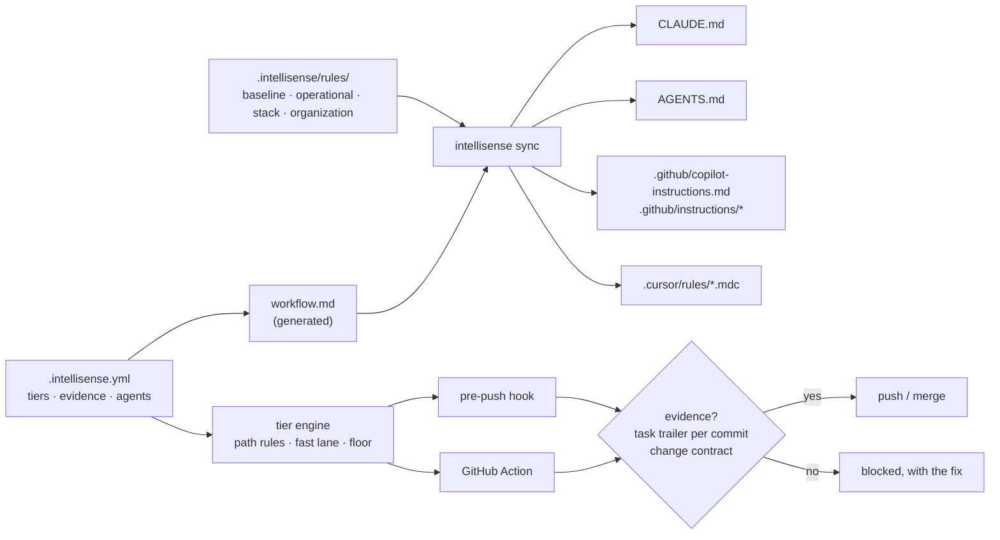

<div align="center">

# Intellisense

### Every AI-written change carries the evidence its risk needs.

**Risk tiers, evidence gates and shared rules for Claude Code, Codex, GitHub Copilot and Cursor, enforced at `git push` and in CI.**

[](LICENSE)
[](CHANGELOG.md)
[](go.mod)
[](#install)

**[Policy reference](docs/policy.md)** · **[Agents](docs/agents.md)** · **[CI](docs/ci.md)** · **[Live mode](docs/live-mode.md)** · **[Changelog](CHANGELOG.md)**

[Quick start](#quick-start) · [What you get](#what-you-get) · [See it work](#see-it-work) · [How it works](#how-it-works) · [Two modes](#two-modes) · [Commands](#commands) · [FAQ](#faq) · [Documentation](#documentation)

</div>

<br />

Coding agents write a lot of code quickly, and they all treat a typo fix and a change to your payment code with the same confidence. Each agent has its own instruction file, so the rules drift: `CLAUDE.md` says one thing, `AGENTS.md` another, and Copilot was never told. A plan and passing tests are things a reviewer has to take on trust.

`intellisense` gives every change in a repository a **risk tier** and blocks a push or pull request that lacks the evidence that tier needs:

- **Tier 2 (high risk):** auth, money, migrations, secrets and the governance policy itself. Needs a task reference and a change contract.
- **Tier 1 (standard):** CI, infrastructure, dependencies, agent instructions and ordinary code. Same evidence, set per repository.
- **Tier 0 (routine):** docs, tests and comment-only edits. Nothing extra.

The same rules are then written into **every agent's own instruction format** from one source, so Claude, Codex, Copilot and Cursor all follow the same workflow. The gate runs in git and CI, so it holds whichever agent (or person) wrote the code.

It is one Go binary with no runtime dependencies besides `git`.

## Quick start

```bash
brew install soupler-oss/tap/intellisense    # or see Install below
cd your-repo
intellisense                 # where am I, and what should I run next?
intellisense init            # a few questions, then: policy, rules, agent instructions, push hook, CI check
intellisense doctor          # checks everything is in place (--fix repairs it)
```

`init` detects your stack, asks which agents and task tracker you use, writes `.intellisense.yml`, and tells you how to commit the result (`--yes` accepts the defaults without asking). It changes nothing outside the repository. Every command ends with what to run next, and `intellisense help <command>` explains it with examples. Adopting is itself a Tier 2 change, so the first commit shows the evidence format:

```bash
git add -A
git commit -m "chore: adopt intellisense governance" \
  -m "Task: PROJ-1" \
  -m "Change Contract: scope=adopt intellisense, risk=low, confidence=0.9"
```

### Install

```bash
brew install soupler-oss/tap/intellisense                                          # macOS, Linux
curl -fsSL https://raw.githubusercontent.com/soupler-oss/intellisense/main/install.sh | sh   # any Unix, no Homebrew
scoop bucket add soupler https://github.com/soupler-oss/scoop-bucket && scoop install intellisense   # Windows
winget install Soupler.Intellisense                                                # Windows
go install github.com/soupler-oss/intellisense/cmd/intellisense@latest             # with Go 1.22+
```

`install.sh` checks the download against the release's `checksums.txt` and installs to `/usr/local/bin` (or `~/.local/bin`). Binaries for macOS, Linux and Windows (amd64/arm64) are also on the [releases](https://github.com/soupler-oss/intellisense/releases) page. Each release also publishes the Homebrew formula, the Scoop manifest and the winget manifests it was packaged with. Step-by-step: [INSTALLATION.md](INSTALLATION.md).

## What you get

| | |
|---|---|
| **Risk tiers from paths** | `.intellisense.yml` maps paths to tiers with regular expressions. Defaults cover auth, money, migrations, secrets, CI, infrastructure, dependencies and agent instructions. Tiers are a list: add a Tier 3, rename one, or change what each needs. |
| **Evidence you choose** | Per tier: a task trailer on each commit, a change contract, a changed test. Task references can be checked against GitHub, Jira, Linear or Beads. |
| **Contracts with a schema** | A contract is a commit line or a Markdown file (`intellisense contract new`), validated against the fields your policy defines. |
| **A gate that blocks the push** | The pre-push hook refuses a push whose Tier 1+ commits lack their task trailer, or whose change lacks a contract, and says exactly how to fix it. |
| **The same gate in CI** | A GitHub Action (`uses: soupler-oss/intellisense@v1.0.0`) runs it on every pull request, with annotations and a job summary. It judges the PR by the policy on the **base** branch, so a PR cannot loosen its own rules. |
| **One rule set, four agents** | `intellisense sync` writes `CLAUDE.md`, `AGENTS.md`, `.github/copilot-instructions.md` plus scoped `.github/instructions/`, and `.cursor/rules/`, all from `.intellisense/rules/`. CI fails when they drift. |
| **Rules worth following** | Security and reasoning-integrity baselines, coding style, testing, proof standards, AI-regression patterns, and rules for Go, PHP/Laravel, Angular, React, Node, Python, Java, Flutter, Rust, C#, Ruby, Swift and C/C++. Add your own language with `custom_stacks`. |
| **No ceremony for safe edits** | A default-tier file whose diff only touches comments drops to Tier 0, unless the comment disables or bypasses something. |
| **Your own rules** | Files in `.intellisense/rules/organization/` reach every agent, optionally scoped to paths. Edit a built-in rule and updates keep your version; switch one off with `rules.disable`. |
| **Claude Code skills** | `/plan`, `/tdd`, `/verify`, `/security-scan` and more, installed per repository with `skills:`. |

## See it work

A branch that adds a login handler, pushed without evidence:

```console
$ git push origin feat/login
── feat/login
intellisense gate: Tier 2 — high risk
  policy   .intellisense.yml @ 18adcc6
  range    18adcc6..894b196  (1 commits, 1 files)
  requires a task trailer on each Tier 1+ commit (Task/Refs/Beads) + a change contract
  Tier 2 because:
    internal/auth/login.go                           auth/identity
  ✗ commit 894b196 "feat: login" is Tier 2 and has no task trailer
      fix: add a trailer line such as "Task: PROJ-123" to that commit's message (accepted keys: Task, Refs, Beads), then `git commit --amend` (or `git rebase -i` for older commits)
  ✗ this change is Tier 2 and has no change contract
      fix: add a line "Change Contract: scope=<scope>, risk=low|medium|high" to a commit message, or run `intellisense contract new "<title>"` and commit the file it writes under .intellisense/contracts/
BLOCKED: 2 problem(s). A false positive? Adjust the rules in .intellisense.yml rather than skipping the gate.

Next:
  git commit --amend                    add the task trailer (for an older commit: git rebase -i)
  intellisense contract new "<title>"   write or fix the change contract
  intellisense gate                     check again
error: failed to push some refs to '../remote.git'
```

The same commit with its evidence:

```console
$ git commit --amend -m "feat: login" -m "Task: PROJ-12" -m "Change Contract: scope=login handler, risk=high, confidence=0.8"
$ git push origin feat/login
  ...
  contract found in commit 4a0cf72
PASSED
 * [new branch]      feat/login -> feat/login
```

Rewording a comment in ordinary code needs nothing:

```console
$ intellisense classify
Tier 0 — routine (docs, tests, comments)
  Tier 0  internal/greet/greet.go                          fast-lane diff only changes comments
```

And an agent instruction file edited by hand, instead of through the rules, fails CI:

```console
$ intellisense sync --check
agent instructions are out of date; run `intellisense sync`:
  changed   .github/copilot-instructions.md
```

## How it works



Each file gets a tier from the first rule it matches, checking the tiers from the highest level down; a file no rule matches gets `default_tier`. The change's tier is the highest file tier, raised to `minimum_tier`. Every commit that is Tier 1+ by its own changes carries its own task trailer: one commit's trailer never covers another. The full model and every key are in the [policy reference](docs/policy.md).

## Two modes

| | **Core mode** (`intellisense init`) | **Live mode** (`intellisense live install`) |
|---|---|---|
| For | Any agent, any team, one repository at a time | Teams using Claude Code |
| Installs | Files in the repo + a git hook. Nothing global | `~/.intellisense`, linked into `~/.claude/` for every session |
| Tiers and evidence | At push and in CI | Also live: each prompt is classified, and a risky edit waits for an approved contract |
| Rules | Portable rules, in each agent's native format | All rules, plus 19 slash-command skills and architect agents |
| Optional extras | — | Commit metadata, telemetry, code-review graph, Beads — each only if you choose it |

There is one tier engine: Live mode's hooks ask the same Go binary, which reads each repository's `.intellisense.yml`, so an edit, a push and CI always agree. Live mode is documented in [docs/live-mode.md](docs/live-mode.md).

## Commands

```bash
intellisense                                    # status: what is set up, and what to run next
intellisense init      [--stack go,react] [--agents …] [--tracker github] [--skills plan,tdd] [--ci] [--yes]
intellisense classify  [PATH...] [--base REF]   # what tier is this change, and why
intellisense contract  new "<title>" | check [FILE] | fields | show FILE | set FILE key=value
intellisense gate      [--base REF] [--format text|json|github]
intellisense check     --base REF --head REF    # CI: gate + sync --check
intellisense sync      [--check]                # write, or check, every agent's instructions
intellisense rules     list | update [--force]  # update keeps rules you edited; organization/ is never touched
intellisense skills    list
intellisense policy    show | validate | get KEY
intellisense hook      install [--chain] | uninstall | status
intellisense doctor    [--fix]
intellisense live      install [--tracker …] [--code-intel …] | status | uninstall | templates check|update
intellisense help      [COMMAND]                # every command, with examples
```

Exit codes: `0` passed, `1` blocked or out of date, `2` error.

## FAQ

<details>
<summary><strong>Who is this for?</strong></summary>

Teams whose code is partly written by coding agents (Claude Code, Codex, Copilot, Cursor) and who want risky changes to arrive with a task and a stated scope and risk, enforced rather than hoped for. Core mode suits any team and any agent; Live mode adds live checks for teams on Claude Code.
</details>

<details>
<summary><strong>Can I skip the gate?</strong></summary>

`git push --no-verify` skips the local hook, but CI runs the same gate and is a required check. A wrong tier is fixed in `.intellisense.yml`, and since that file is Tier 2, the fix needs its own evidence and review.
</details>

<details>
<summary><strong>We use Jira / Linear / GitHub issues, not Beads.</strong></summary>

Pick your tracker at `init` (`--tracker jira`): it sets the trailer keys (`Jira: PROJ-12`), and `evidence.verify_tasks: true` checks each reference exists. Beads is never required, in either mode.
</details>

<details>
<summary><strong>Does it read my code or send anything anywhere?</strong></summary>

Core mode makes no network call unless you turn on `verify_tasks`, which asks your own tracker about task IDs. Telemetry exists only in Live mode, is off unless you configure a collector, and sends counts, never content ([contract](docs/telemetry-contract.md)).
</details>

<details>
<summary><strong>Will it overwrite my changes?</strong></summary>

No. `rules update` and `live templates update` refresh only files you have not edited and list the ones they kept; `--force` replaces them, keeping a backup. `.intellisense/rules/organization/` is never touched.
</details>

<details>
<summary><strong>Does it work with repo-governance?</strong></summary>

Yes. [repo-governance](https://github.com/soupler-oss/repo-governance) governs a repository's docs, branches and PRs; intellisense governs the risk of each code change. With `features.intellisense` on, repo-governance installs the pre-push hook and the CI check that run the gate, makes "Intellisense Gate" a required check, and runs `intellisense init` for each repository it generates.
</details>

<details>
<summary><strong>What about monorepos?</strong></summary>

Tier rules are path patterns, so `services/payments/` and `apps/web/` can carry different tiers. Organization rules can be scoped to paths with `globs:`.
</details>

<details>
<summary><strong>Which agents read what?</strong></summary>

See [docs/agents.md](docs/agents.md): what each file contains, size limits, and how scoping works per agent.
</details>

## Status

**1.0**: configurable risk tiers and contracts, one tier engine for both modes, optional integrations, and a guided command line. CI runs the Go suite on macOS, Linux and Windows and the Bash suite on macOS and Linux for every change. Release notes are in the [CHANGELOG](CHANGELOG.md).

- The CI check ships as a GitHub Action. On other CI systems, run `intellisense check --base <ref> --head <ref>` in a job: it exits `1` when the change is blocked.
- Live mode needs bash (macOS, Linux or WSL) and Claude Code. Core mode runs anywhere `git` does, Windows included.
- Live mode's optional extras (Beads, code-review-graph, telemetry) are separate tools, installed only if you choose them.

## Documentation

- **[Policy reference](docs/policy.md)**: tiers, evidence, the contract schema, stacks, rules and integrations; every key in `.intellisense.yml`
- **[Agents](docs/agents.md)**: what each agent's instruction file contains, and how scoping works
- **[CI](docs/ci.md)**: the GitHub Action, other CI systems, and making the gate a required check
- **[Live mode](docs/live-mode.md)**: live checks inside Claude Code, per-repository rules and templates, optional tools
- **[Installation](INSTALLATION.md)** and **[Quick start](QUICK_START.md)**: step by step, for both modes
- **[Changelog](CHANGELOG.md)**

## Contributing

Issues and pull requests are welcome. Read [CONTRIBUTING.md](CONTRIBUTING.md) first, and [CLAUDE.md](CLAUDE.md) before changing anything: it explains the architecture and the rules for this repository. Branch from `develop` and open the pull request against `develop`; `main` only receives `develop`. Questions go to [Discussions](https://github.com/soupler-oss/intellisense/discussions), security problems to [SECURITY.md](SECURITY.md), and everyone follows the [Code of Conduct](CODE_OF_CONDUCT.md).

This repository is governed by its own gate (its `.intellisense.yml`) and by [repo-governance](https://github.com/soupler-oss/repo-governance)'s docs gate, hooks and PR checks.

```bash
bash bin/install-hooks.sh          # once per clone
bash scripts/ci/test.sh            # Go and Bash suites, as CI runs them
bash scripts/ci/lint.sh            # gofmt, go vet, bash -n, JSON
bash bin/statutory-integrity.sh    # the docs gate CI runs
go run ./cmd/intellisense classify # the tier of your change, before you commit
```

## License

Copyright 2026 Soupler. [Apache License 2.0](LICENSE); see also [`NOTICE`](NOTICE). Contributions are accepted under the same licence. **What it writes is yours:** the licence places no restriction on the policy files, contracts and agent instructions intellisense writes into your repositories. The licence doesn't grant use of the Soupler name or logo.
